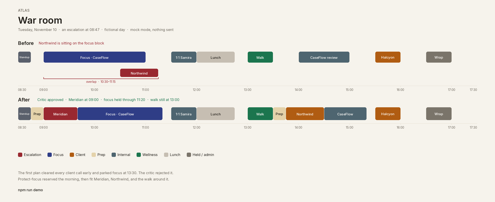
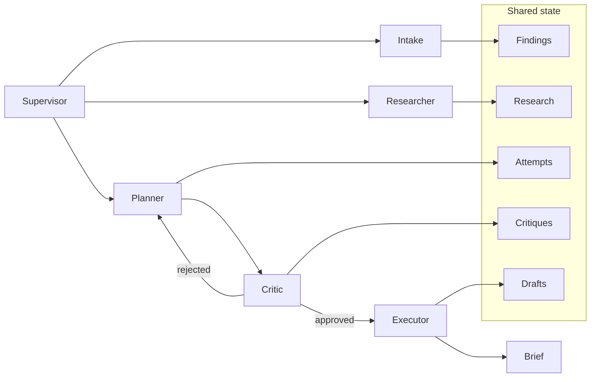
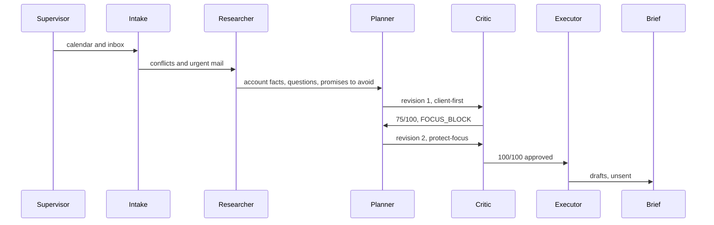

# Atlas

**[Play the war room locally](#browser-demo)** — `npm run preview`, then open [http://127.0.0.1:4173](http://127.0.0.1:4173). Mock mode, no API key, nothing is sent.

An escalation lands at 8:47. The calendar was already double-booked. **Atlas** is a small swarm that rewrites the day, protects a morning focus block, and drafts the email and the Slack note. Nothing is sent.

The Tuesday in the fixture belongs to Jordan Hale, a fictional client-support analyst who is also holding time to build a tool (CaseFlow) and to take a short wellness walk. Accounts, payers, and case ids are invented. The demo runs with no API keys.

The picture below is the approved rewrite. The browser demo plays the swarm that gets there: war room, day plan, and morning brief.

```bash
npm install
npm run demo
```



## What the hero demo does

`npm run demo` opens the war room on that Tuesday.

1. **Intake** reads the calendar and the inbox. Northwind's quarterly review already overlaps the CaseFlow focus block, and Dana Okonkwo has asked for a call before a 1:00 CFO review.
2. **Research** pulls Meridian Medical Group off the fixture: strategic account, go-live Friday, case `CS-10442`, last touch six days ago with no written follow-up.
3. **Planner, first pass** clears client calls as early as it can. Focus gets the largest hole left, which starts at 13:30. The biggest hole is the wrong hole.
4. **Critic** scores that plan 75/100 and hands it back with `FOCUS_BLOCK`. Lunch, the walk, the fixed 1:1, and the payer window were fine. The morning was not.
5. **Planner, second pass** switches to `protect-focus`: Meridian at 09:00–09:40, focus held 09:40–11:20, Northwind moved to 13:45, the walk left at 13:00.
6. **Executor** writes calendar diffs plus an email draft and a Slack draft, all marked `draft`.
7. **Brief** prints the three outcomes and a call card: what we know, what to ask, what not to promise.

The exchange that matters:

```text
08:47:34  CRITIC      75/100 · rejected
              FOCUS_BLOCK. Focus landed at 13:30–15:20. The escalation is allowed
              to shift it, not to push it out of the morning. The largest open gap
              was the wrong gap.
              → planner  Switch to protect-focus.

08:47:50  CRITIC      100/100 · approved
              Focus, the walk, lunch, the fixed meetings, and the deadline all hold.
              → executor  Materialize drafts. Do not send them.

08:48:06  BRIEF       Meridian gets 09:00. The morning focus block still happens.
              1. Take Dana at 09:00–09:40 and send the written status by 12:15.
              2. Keep 09:40–11:20 for the CaseFlow denial queue.
              3. Move Northwind to 13:45–14:30.
```

The figure at the top is that approved day. `npm test` locks the same times.

## Three pillars

### 1. Calendar and day planning

A busy support day has priorities that are easy to violate by accident: a focus block for building, a walk that can slide and cannot vanish, a 1:1 that does not move, a payer window someone else owns.

```bash
npm run demo:plan    # the overlap, the rejected plan, the diff
npm run demo:brief   # the same Tuesday as a morning brief, before 08:47
```

`demo:plan` is the planning loop with no escalation. The calendar is already lying: Northwind sits on the focus block. Client-first scheduling then picks a 110-minute afternoon hole over a 95-minute morning one, and the critic rejects it. Protect-focus puts 09:00–11:00 back and moves the review to 13:45. The brief turns that into three outcomes.

### 2. Multi-agent orchestration

One supervisor. One blackboard. Specialists that do not call each other.





| Piece | Where | Job |
| --- | --- | --- |
| Supervisor | `src/orchestrator/supervisor.ts` | The only router. Caps the loop at three revisions. |
| Blackboard | `src/memory/state.ts`, `RunState` in `src/types.ts` | Findings, research, every plan attempt, critiques, drafts, the trace. |
| Roles | `src/agents/roles.ts` | The contract each specialist would keep if a model sat behind it. |
| Agents | `src/agents/*.ts` | Intake, research, plan, critique, execute, brief. |
| Tools | `src/tools/toolkit.ts` | Read-only calendar, inbox, and account lookup. |
| Critic | `src/schedule/critique.ts` | A named checklist. It does not quietly fix the plan. |

`npm run demo:trace` prints the war room as JSON: handoffs, scores, the approved schedule, and the unsent drafts.

### 3. War room, the hero

Pillars 1 and 2 are the machinery. The war room is the demo you can finish in a few minutes: email, then research, then a schedule argument, then calendar moves, a Slack draft, an email draft, and a call card.

The pipeline is the whole `npm run demo` run. The call card is specific on purpose. It tells Jordan to ask whether the November 4 payer-id change reached production, and to leave Friday's go-live unpromised until the diff is on the screen.

## Design choices

1. **The schedule is a pure function.** Two strategies live in `src/schedule/plan.ts`. `client-first` places client meetings early, keeps lunch and the walk, then drops focus into the largest remaining gap. `protect-focus` places a true escalation first, reserves a morning block of at least 90 minutes, then fits everyone else. Re-running the demo prints the same day.
2. **A model is optional prose polish.** `npm run demo` is mock mode even if a key is sitting in the environment. `npm run demo:live` can restyle the brief and the drafts when `ATLAS_PROVIDER=openai` and `OPENAI_API_KEY` are set. The prompt tells it to keep times, names, and case ids. Schedule decisions stay in `plan.ts`. If the call fails, the deterministic draft stands.
3. **The critic is allowed to say no.** The handoff is a named failure. The planner picks the next strategy from that failure.
4. **Drafts stay in the process.** Calendar, email, and Slack actions are `status: "draft"`. There is no send path to wire by accident.
5. **The constraints are the point.** Focus has a 90-minute floor. The wellness walk can move up to 90 minutes and cannot be deleted. Samira's 1:1 and Halcyon's 15:30 window are fixed. Client calls get a prep buffer. Fixed meetings keep a 10-minute lead-in.
6. **Small modules.** No agent framework. The supervisor is about a hundred lines. The whole `src/` tree is there to be read.

## Sample day

Tuesday, November 10, 2026. Working hours 08:30–17:30.

| When | What | Rule |
| --- | --- | --- |
| 08:30–08:45 | Team standup | Fixed |
| 09:00–11:00 | Focus · CaseFlow denial queue | Protected, floor 90 minutes |
| 10:30–11:15 | Northwind Health quarterly review | Movable, and already overlapping focus |
| 11:30–12:00 | 1:1 with Samira | Fixed |
| 12:00–12:45 | Lunch | At least 30 minutes, around noon |
| 13:00–13:30 | Wellness walk | Protected, may slide, may not disappear |
| 14:00–15:00 | CaseFlow design review | Movable |
| 15:30–16:00 | Halcyon Benefits · batch 441 | Fixed payer window |
| 16:30–17:00 | Wrap | Movable |

At 08:47 Dana Okonkwo writes from Meridian Medical Group. Go-live is Friday. About 140 claims are stuck in pending remit. She needs a morning call and a written status before 12:15. The fixture lives in `src/fixtures/tuesday.ts`.

## Browser demo

The page in `docs/` runs the same `runWorkflow` function as the CLI. Play, pause, or step the war room. The critic rejects the first plan, then the day flips. **Day plan** and **Brief** are the other tabs. Drafts are labeled not sent. Deep links: `#war`, `#plan`, `#brief`.

```bash
npm install
npm run preview
```

Open [http://127.0.0.1:4173](http://127.0.0.1:4173).

### Sharing it while the source stays private

Public GitHub Pages is not available to hiring teams on a private repository. This repo is meant to stay private, so `https://saltylvn.github.io/agentic-workflows/` is not a public hiring link. The demo is a static folder (`docs/index.html`, `docs/styles.css`, `docs/app.js`) with no keys in it. Publish that folder on its own if you want a passwordless URL:

- Deploy `docs/` to any public static host (Netlify, Cloudflare Pages, S3, a separate **public** repo that contains only that folder).
- Or, only if this repository is public, enable GitHub Pages with source **GitHub Actions**. `.github/workflows/pages.yml` publishes `docs/` on each push to `main`, at `https://saltylvn.github.io/agentic-workflows/`.

Making the repository private turns that Pages URL off for anyone without repo access. The local preview keeps working.

## Run it

Node 20 or newer.

```bash
npm install
npm test
npm run typecheck
npm run demo
npm run demo:plan
npm run demo:brief
npm run demo:trace
npm run demo:all
```

| Script | What you get |
| --- | --- |
| `npm run demo` | War room. The hero. |
| `npm run demo:plan` | Day planner: priorities, the conflict, both revisions, the diff. |
| `npm run demo:brief` | Morning brief for the same Tuesday, inbox still quiet. |
| `npm run demo:trace` | War room as JSON, including role cards and unsent drafts. |
| `npm run demo:all` | Plan, brief, then war room. |
| `npm run demo:live` | Same as `demo`, with optional prose polish. |
| `npm test` | Scheduler properties and both workflows. |
| `npm run preview` | Browser demo on port 4173. |
| `npm run build:web` | Rebuild `docs/app.js` for GitHub Pages. |
| `npm run typecheck` | `tsc --noEmit`, including the browser demo. |

Mock mode is the default, including when `OPENAI_API_KEY` happens to be set. Live polish is opt-in:

```bash
cp .env.example .env
# ATLAS_PROVIDER=openai
# OPENAI_API_KEY=...
npm run demo:live
```

`.env` is gitignored. The example file has empty values. Fixture addresses use `*.example`.

Color follows the terminal. Set `NO_COLOR=1` for plain text.

## Layout

```text
src/
  agents/            one file per specialist, plus role cards
  orchestrator/      supervisor loop
  memory/            trace and finding helpers
  schedule/          strategies, critique checklist, draft builder
  tools/             read-only calendar, inbox, accounts
  providers/         mock model, optional OpenAI prose polish
  fixtures/          the Tuesday
  render/            terminal layout
  cli.ts             war-room | plan | brief | trace | all
web/main.ts          browser shell around the same swarm
docs/                GitHub Pages demo (index, styles, built app.js)
tests/               node:test, via tsx
docs/war-room.png    the approved rewrite
```

A good reading order: `src/orchestrator/supervisor.ts`, `src/schedule/plan.ts`, `src/schedule/critique.ts`, `src/fixtures/tuesday.ts`.

## License

[MIT](LICENSE).
