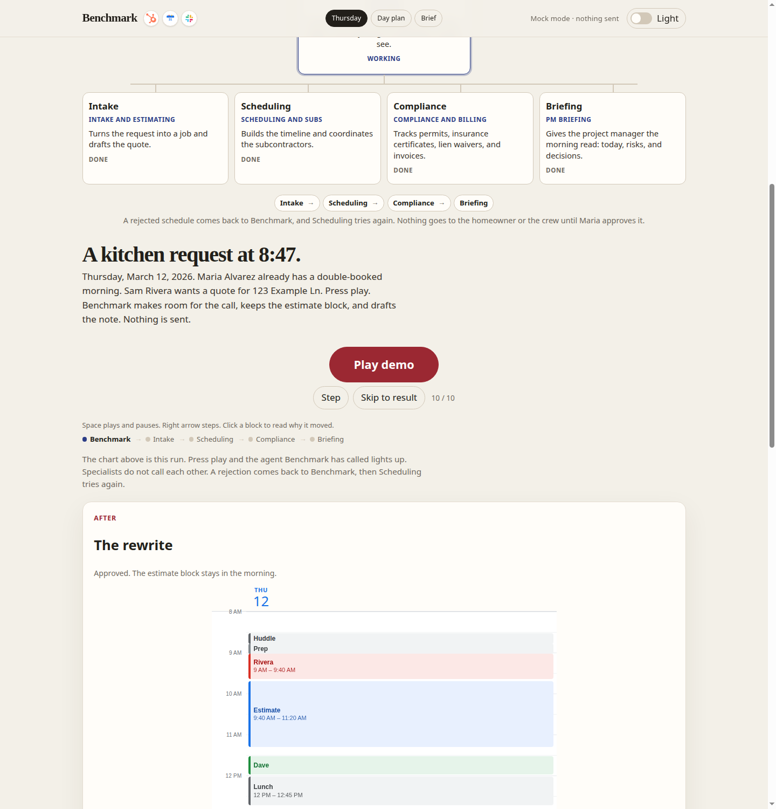
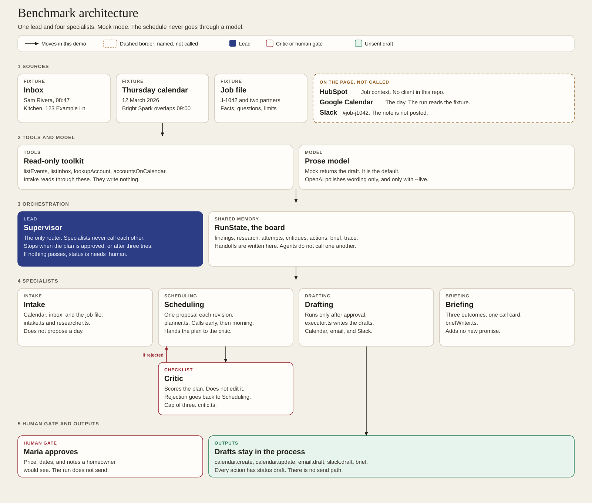
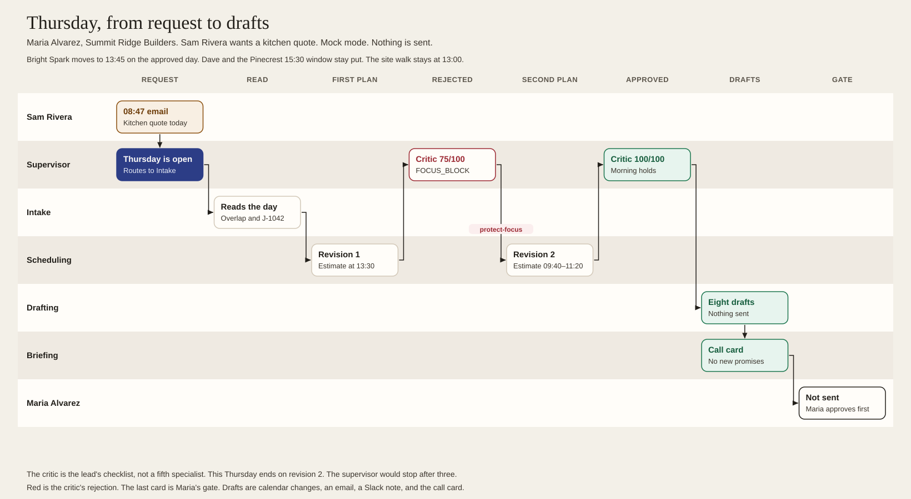
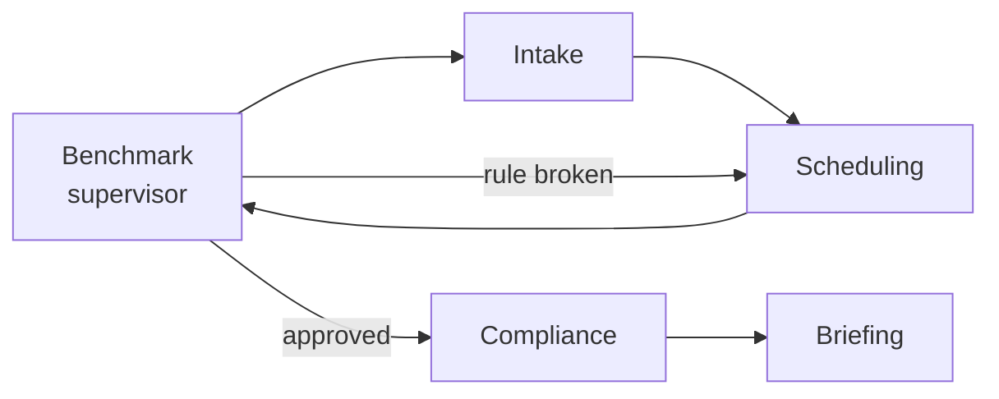
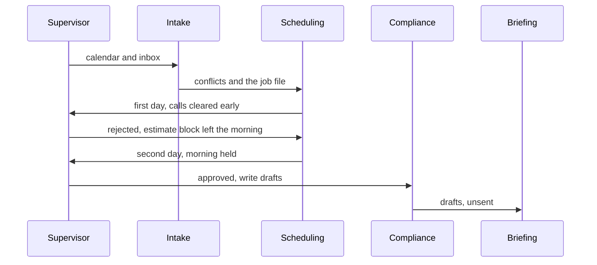
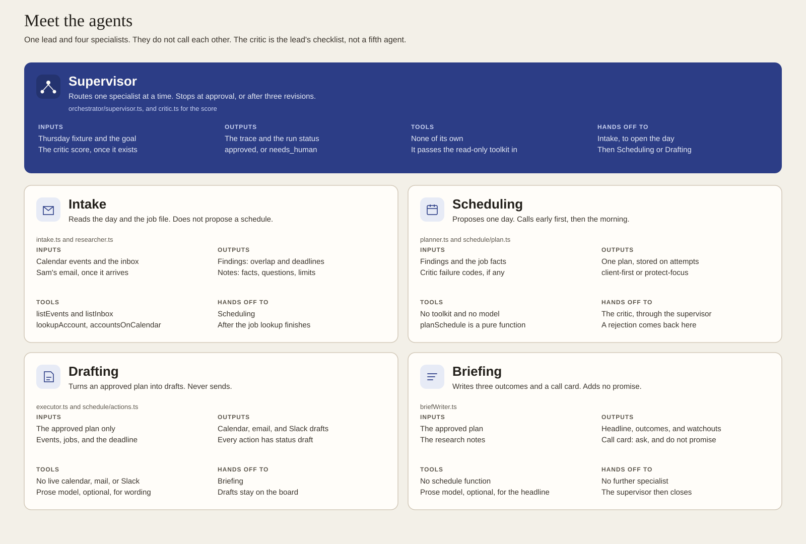
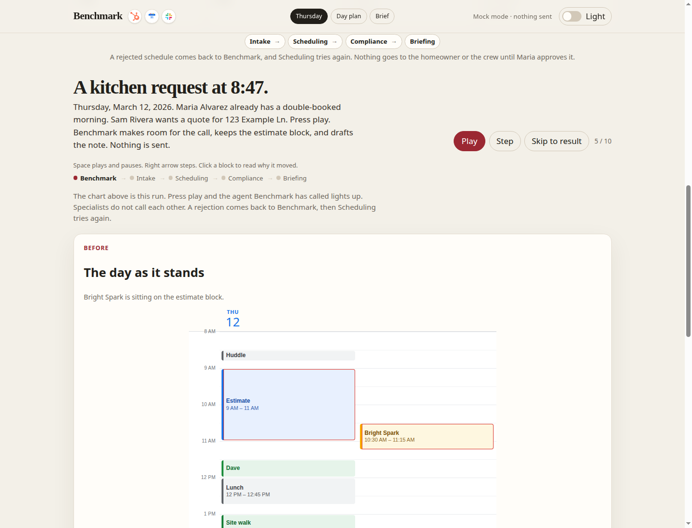
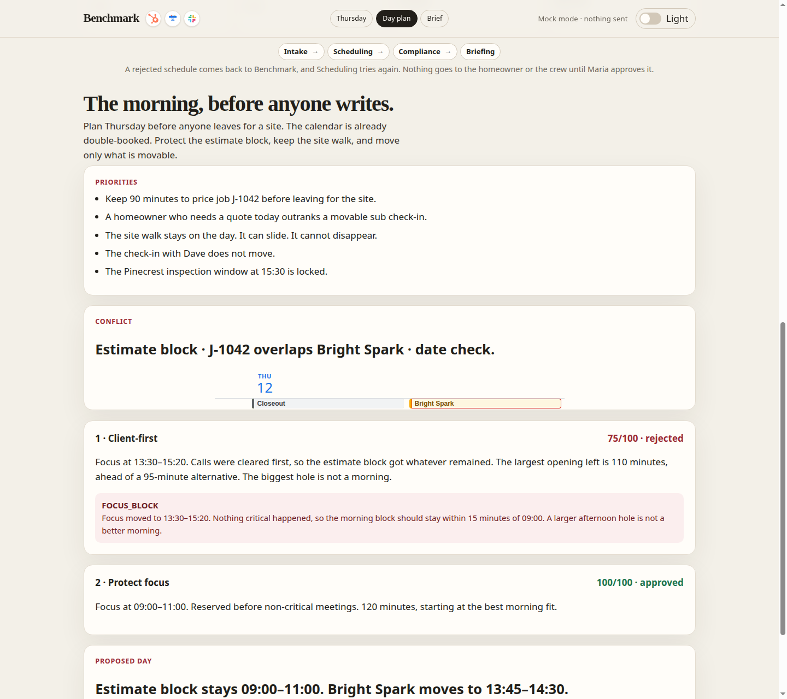
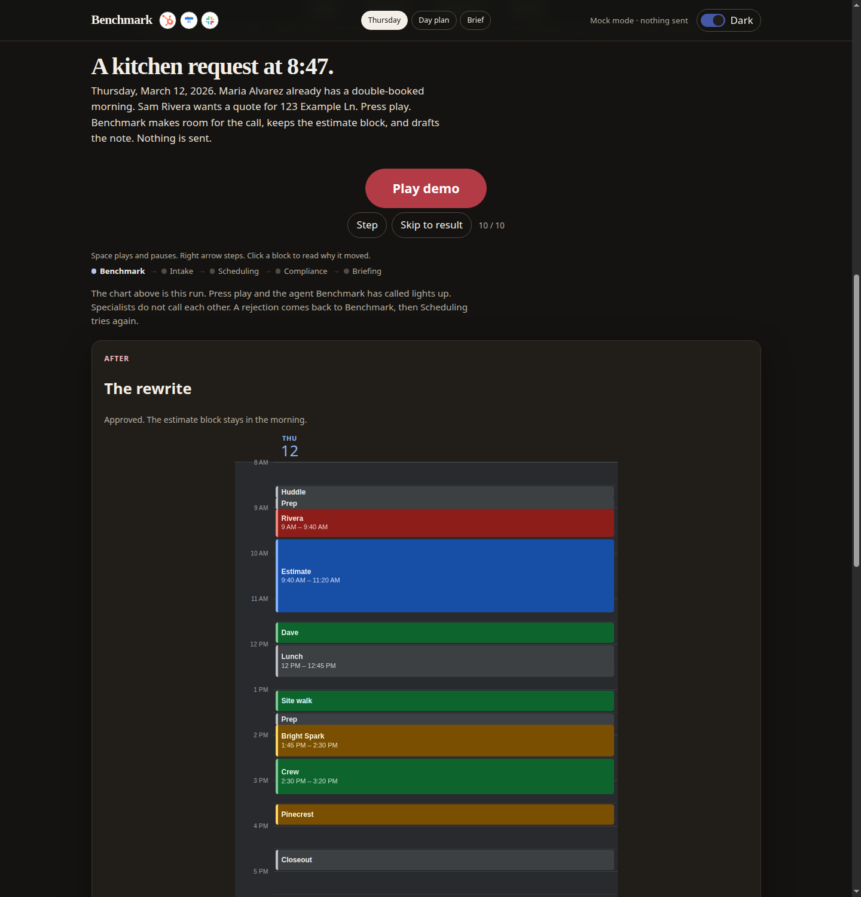
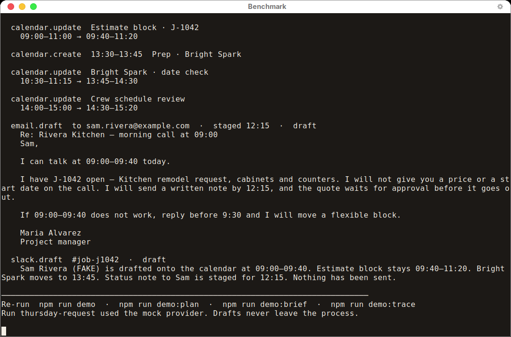

# Benchmark

Benchmark is a team of agents for a construction project manager. The hours disappear into the same loop: a homeowner email, a quote that still needs a price, a calendar that is already double-booked, a subcontractor whose paperwork is stale, and a note that should go out before lunch. Benchmark runs that morning for a fictional project manager and stops at drafts. The project manager still approves the money, the dates, and anything a homeowner would see.

The playable story is one Thursday for Maria Alvarez at Summit Ridge Builders. Names, the address, and the job id are invented. Nothing in the demo is sent.







## How it works

One lead, four specialists. The lead is the supervisor. It does not price the job and it does not text the crew. It hands the work to one specialist at a time, and it is the only one that decides who goes next.

| Specialist | Job on this Thursday |
| --- | --- |
| **Intake** | Reads the calendar and the inbox, then pulls the job file: what is known, what to ask, and what not to promise. |
| **Scheduling** | Proposes a day. The first pass clears calls early. If that pushes the estimate block out of the morning, the lead rejects it and Scheduling tries again with the morning held. |
| **Compliance** | Turns the approved day into calendar changes, an email draft, and a Slack draft. It also carries the expired insurance certificate into that note. |
| **Briefing** | Writes the morning brief: three outcomes and a call card. |

The lead's check is a named checklist. It scores the plan and hands it back. It does not quietly rewrite the day. Specialists do not call each other. The header shows HubSpot, Google Calendar, and Slack. Those are the systems the day is about. Mock mode reads the Thursday fixture through the toolkit and does not call them.





In the source, Intake is `src/agents/intake.ts` plus the job lookup in `src/agents/researcher.ts`. Scheduling is `src/agents/planner.ts`. The checklist the lead applies is `src/agents/critic.ts` and `src/schedule/critique.ts`. Compliance is `src/agents/executor.ts`. Briefing is `src/agents/briefWriter.ts`. The supervisor in `src/orchestrator/supervisor.ts` is the only router, and it stops after three revisions.

## Meet the agents

Five cards, taken from the source. The supervisor is the only router. Intake, Scheduling, Compliance, and Briefing do not call each other. The critic is the checklist the supervisor runs between Scheduling and the next hand-off. It is not a fifth specialist.



## A Thursday at Summit Ridge

Thursday, March 12, 2026. Maria Alvarez, project manager. Working hours 08:30–17:30.

| When | What | Rule |
| --- | --- | --- |
| 08:30–08:45 | Morning huddle | Fixed |
| 09:00–11:00 | Estimate block for job J-1042 | Protected, at least 90 minutes, and it stays in the morning |
| 10:30–11:15 | Bright Spark date check | Movable, and already sitting on the estimate block |
| 11:30–12:00 | Check-in with Dave | Fixed |
| 12:00–12:45 | Lunch | At least 30 minutes, around noon |
| 13:00–13:30 | Site walk at 123 Example Ln | Can slide, cannot disappear |
| 14:00–15:00 | Crew schedule review | Movable |
| 15:30–16:00 | Pinecrest rough-in window | Fixed county window |
| 16:30–17:00 | Daily closeout | Movable |

At 08:47 Sam Rivera (FAKE) writes about a kitchen at 123 Example Ln. Sam wants a call this morning and a written note by 12:15. The draft total on the job file is $38,450. Maria has not approved it. Bright Spark Electric's insurance certificate is expired, so the electrician is not confirmed. Rain may move Friday's demolition.

Press play. Intake reads the overlap and the email. Scheduling's first day puts Sam at 09:00–09:40 and parks the estimate block at 13:30–15:20, because that afternoon hole is larger. The lead scores that plan 75/100 and rejects it: the request may shift the estimate block, not push it out of the morning. Scheduling's second day holds the block at 09:40–11:20, moves Bright Spark to 13:45–14:30, and leaves the site walk at 13:00. The lead scores that plan 100/100.

Compliance then stages an email to Sam and a Slack note in `#job-j1042`. Both say they have not been sent. Briefing prints three outcomes and a call card: ask about the budget and the cabinet scope, and do not promise a price, a start date, or that the electrician is confirmed.



The same morning, before Sam's email, is the Day plan tab. The calendar is already wrong. Bright Spark sits on the estimate block. The rewrite gives 09:00–11:00 back to the estimate and moves the date check to 13:45. No email is invented.



`npm test` locks those times. The quote total, when one is shown, is added by code.

## Design choices

**Mock mode is the default.** `npm run demo` and the page run with no API key, even if a key is sitting in the environment. A model is optional prose polish only. `npm run demo:live` can restyle the brief and the drafts when `BENCHMARK_PROVIDER=openai` and `OPENAI_API_KEY` are set. The prompt tells it to keep times, names, and job ids. If the call fails, the deterministic draft stands.

**Drafts are never sent.** Calendar, email, and Slack actions are `status: "draft"`. There is no send path to wire by accident.

**A person still approves the day.** The lead can reject a plan, and it can stop after three revisions. It cannot approve a price or a start date. The call card tells Maria what not to promise.

**The schedule is a pure function.** Two strategies live in `src/schedule/plan.ts`. `client-first` places the new call and the other movable meetings early, keeps lunch and the site walk, then drops the estimate block into the largest hole left. `protect-focus` places the kitchen request first, reserves a morning block of at least 90 minutes, then fits everyone else. Re-running the demo prints the same day.

**The constraints are the point.** The estimate block has a 90-minute floor. The site walk can move up to 90 minutes and cannot be deleted. Dave's check-in and the Pinecrest 15:30 window are fixed. Calls get a prep buffer. Fixed meetings keep a 10-minute lead-in.



## Tech stack

TypeScript on Node 20 or newer. No agent framework. The tests use `node:test`, run through `tsx`. The page is `web/main.ts` bundled by esbuild into `docs/app.js`, with plain HTML and CSS beside it. The page and the CLI call the same `runWorkflow` function. Optional prose polish is one OpenAI chat call. Schedule decisions, quote totals, and dates stay in code.

## Run it

```bash
npm install
npm test
npm run typecheck
npm run preview
```

`npm run preview` rebuilds the page and serves it at [http://127.0.0.1:4173](http://127.0.0.1:4173). The page follows the system light or dark setting. The switch at the top right flips between them. Play, pause, or step Thursday. When the run finishes, the button reads **Play demo**. Deep links: `#thursday`, `#plan`, `#brief`.

| Script | What you get |
| --- | --- |
| `npm test` | Scheduler checks and both workflows. |
| `npm run typecheck` | `tsc --noEmit` for the CLI and the page. |
| `npm run preview` | The static demo on port 4173. |
| `npm run demo` | Thursday in the terminal. |
| `npm run demo:plan` | The morning before Sam's email. |
| `npm run demo:brief` | That same morning as a brief. |
| `npm run demo:trace` | Thursday as JSON, including unsent drafts. |
| `npm run demo:all` | Plan, brief, then Thursday. |
| `npm run demo:live` | Thursday, with optional prose polish. |
| `npm run build:web` | Rebuild `docs/app.js`. |



Mock mode is the default. Live polish is opt-in:

```bash
cp .env.example .env
# BENCHMARK_PROVIDER=openai
# OPENAI_API_KEY=...
npm run demo:live
```

`.env` is gitignored. The example file has empty values. Fixture addresses use `example` domains.

Color follows the terminal. Set `NO_COLOR=1` for plain text.

## Project structure

```text
src/
  agents/            Intake, job lookup, Scheduling, the lead's checklist, Compliance, Briefing
  orchestrator/      supervisor loop
  memory/            trace and finding helpers
  schedule/          the two strategies, the checklist, the draft builder
  tools/             read-only calendar, inbox, and job lookup
  providers/         mock model, optional OpenAI prose polish
  fixtures/          Thursday for Maria Alvarez
  render/            terminal layout
  cli.ts             thursday | plan | brief | trace | all
web/main.ts          browser shell around the same team
docs/                static demo: index.html, styles.css, app.js, images/
tests/               node:test, via tsx
```

A useful reading order is `src/orchestrator/supervisor.ts`, `src/schedule/plan.ts`, `src/schedule/critique.ts`, then `src/fixtures/thursday.ts`.

## Publish the static demo

`docs/` is a site by itself: `index.html`, `styles.css`, `app.js`, and `images/`. It does not import the rest of this repository and it does not need an API key. Copy that folder to a public repository or any static host and serve it as the site root. Keep `.nojekyll` in the folder so GitHub Pages serves the files as they are.

The page's only outbound link is [github.com/saltylvn/benchmark-ai](https://github.com/saltylvn/benchmark-ai).

From this repository, `npm run build:web` rewrites `docs/app.js` after a change to `web/main.ts`. If this repository is public, `.github/workflows/pages.yml` publishes `docs/` to [saltylvn.github.io/benchmark-ai](https://saltylvn.github.io/benchmark-ai/).

## Working together

Claude Code leads architecture and direction. Cursor handles cleanup, docs, visuals, and the showcase. See [docs/COLLABORATION.md](docs/COLLABORATION.md) and [docs/PROGRESS.md](docs/PROGRESS.md).

## License

[MIT](LICENSE).
