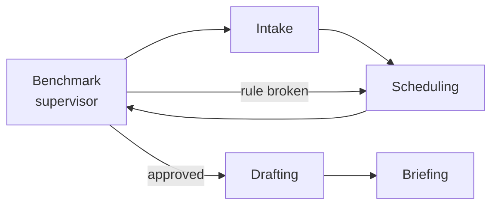
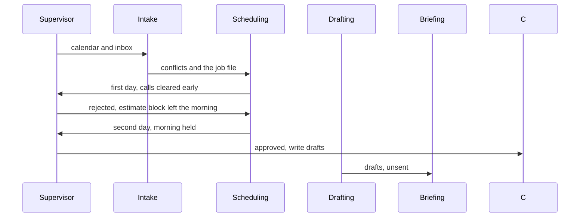

# Benchmark

A team of agents that gives a construction project manager the day back, and stops at drafts.

[](https://github.com/saltylvn/benchmark-ai/actions/workflows/ci.yml)

The badge points at the CI workflow on the dashboard pull request. It stays empty until that workflow is on `main`.

Benchmark takes one fictional Thursday, reads a double-booked calendar and a homeowner email, and leaves calendar, email, and Slack drafts for Maria Alvarez to approve. Nothing is sent.

## Tech stack

TypeScript on Node 20 or newer. Tests use `node:test` through `tsx`. The page is `web/main.ts` bundled by esbuild into `docs/app.js`. Schedule decisions stay in code. An optional OpenAI call can restyle prose only. A Python dashboard that reads an exported snapshot is in progress on a separate branch. This repository does not call it yet.

## What I built, and the design decisions

The runnable piece is one Thursday for Maria Alvarez at Summit Ridge Builders. Intake reads the day, Scheduling proposes it, a checklist can reject the first plan, Drafting writes unsent drafts, and Briefing writes the call card. The supervisor is the only router. Drafts stay `status: "draft"` because there is no send path. Mock mode is the default even when an API key is present. The page in `docs/` is the same function as the CLI, and it can be copied out and published on its own.

## What's next

The dashboard branch owns the single time ledger in `dashboard/assumptions.json`, and a later compliance-and-billing specialist. That specialist is not the drafting step in this demo. Slack live-send is off by default, sends only after a PM approves. Screenshots of the dashboard belong here after that branch merges. A calendar connector with the same two locks is planned, not built.

The playable story is one Thursday for Maria Alvarez at Summit Ridge Builders. Names, the address, and the job id are invented. Nothing in the demo is sent.


## How it works

One lead, four specialists. The lead is the supervisor. It does not price the job and it does not text the crew. It hands the work to one specialist at a time, and it is the only one that decides who goes next.

| Specialist | Job on this Thursday |
| --- | --- |
| **Intake** | Reads the calendar and the inbox, then pulls the job file: what is known, what to ask, and what not to promise. |
| **Scheduling** | Proposes a day. The first pass clears calls early. If that pushes the estimate block out of the morning, the lead rejects it and Scheduling tries again with the morning held. |
| **Drafting** | Turns the approved day into calendar changes, an email draft, and a Slack draft. The expired insurance certificate is already on the job file. |
| **Briefing** | Writes the morning brief: three outcomes and a call card. |

The lead's check is a named checklist. It scores the plan and hands it back. It does not quietly rewrite the day. Specialists do not call each other. The header shows HubSpot, Google Calendar, and Slack. Those are the systems the day is about. Mock mode reads the Thursday fixture through the toolkit and does not call them.





In the source, Intake is `src/agents/intake.ts` plus the job lookup in `src/agents/researcher.ts`. Scheduling is `src/agents/planner.ts`. The checklist the lead applies is `src/agents/critic.ts` and `src/schedule/critique.ts`. Drafting is `src/agents/executor.ts`. Briefing is `src/agents/briefWriter.ts`. The supervisor in `src/orchestrator/supervisor.ts` is the only router, and it stops after three revisions. The name Drafting is the display name, so a later compliance-and-billing specialist can have its own name.

## Meet the agents

Five cards, taken from the source. The supervisor is the only router. Intake, Scheduling, Drafting, and Briefing do not call each other. The critic is the checklist the supervisor runs between Scheduling and the next hand-off. It is not a fifth specialist.


## Showcase

[docs/SHOWCASE.md](docs/SHOWCASE.md) walks through the drawings in `docs/images/showcase/`. Green means the demo runs it. Amber means it is planned and not in the code. Minute counts are estimates from [docs/TIME_SAVED.md](docs/TIME_SAVED.md), not measurements.


## A Thursday at Summit Ridge

Thursday, March 12, 2026. Maria Alvarez, project manager. Working hours 08:30–17:30.

| When | What | Rule |
| --- | --- | --- |
| 08:30–08:45 | Morning huddle | Fixed |
| 09:00–11:00 | Estimate block for job J-1042 | Protected, at least 90 minutes, and it stays in the morning |
| 10:30–11:15 | Bright Spark date check | Movable, and already sitting on the estimate block |
| 11:30–12:00 | Check-in with Dave | Fixed |
| 12:00–12:45 | Lunch | At least 30 minutes, around noon |
| 13:00–13:30 | Site walk at 123 Example Ln | Can slide, cannot disappear |
| 14:00–15:00 | Crew schedule review | Movable |
| 15:30–16:00 | Pinecrest rough-in window | Fixed county window |
| 16:30–17:00 | Daily closeout | Movable |

At 08:47 Sam Rivera (FAKE) writes about a kitchen at 123 Example Ln. Sam wants a call this morning and a written note by 12:15. The draft total on the job file is $38,450. Maria has not approved it. Bright Spark Electric's insurance certificate is expired, so the electrician is not confirmed. Rain may move Friday's demolition.

Press play. Intake reads the overlap and the email. Scheduling's first day puts Sam at 09:00–09:40 and parks the estimate block at 13:30–15:20, because that afternoon hole is larger. The lead scores that plan 75/100 and rejects it: the request may shift the estimate block, not push it out of the morning. Scheduling's second day holds the block at 09:40–11:20, moves Bright Spark to 13:45–14:30, and leaves the site walk at 13:00. The lead scores that plan 100/100.

Drafting then stages an email to Sam and a Slack note in `#job-j1042`. Both say they have not been sent. Briefing prints three outcomes and a call card: ask about the budget and the cabinet scope, and do not promise a price, a start date, or that the electrician is confirmed.


The same morning, before Sam's email, is the Day plan tab. The calendar is already wrong. Bright Spark sits on the estimate block. The rewrite gives 09:00–11:00 back to the estimate and moves the date check to 13:45. No email is invented.


`npm test` locks those times. The quote total, when one is shown, is added by code.

## Design choices

**Mock mode is the default.** `npm run demo` and the page run with no API key, even if a key is sitting in the environment. A model is optional prose polish only. `npm run demo:live` can restyle the brief and the drafts when `BENCHMARK_PROVIDER=openai` and `OPENAI_API_KEY` are set. The prompt tells it to keep times, names, and job ids. If the call fails, the deterministic draft stands.

**Drafts are never sent.** Calendar, email, and Slack actions are `status: "draft"`. There is no send path to wire by accident.

**A person still approves the day.** The lead can reject a plan, and it can stop after three revisions. It cannot approve a price or a start date. The call card tells Maria what not to promise.

**The schedule is a pure function.** Two strategies live in `src/schedule/plan.ts`. `client-first` places the new call and the other movable meetings early, keeps lunch and the site walk, then drops the estimate block into the largest hole left. `protect-focus` places the kitchen request first, reserves a morning block of at least 90 minutes, then fits everyone else. Re-running the demo prints the same day.

**The constraints are the point.** The estimate block has a 90-minute floor. The site walk can move up to 90 minutes and cannot be deleted. Dave's check-in and the Pinecrest 15:30 window are fixed. Calls get a prep buffer. Fixed meetings keep a 10-minute lead-in.


## Tech stack

TypeScript on Node 20 or newer. No agent framework. The tests use `node:test`, run through `tsx`. The page is `web/main.ts` bundled by esbuild into `docs/app.js`, with plain HTML and CSS beside it. The page and the CLI call the same `runWorkflow` function. Optional prose polish is one OpenAI chat call. Schedule decisions, quote totals, and dates stay in code.

## The team view

One PM's day is the hero story. Benchmark's day-to-day job is the whole team: every job, every PM, every sub.

Each morning the **Coordinator** (`src/agents/coordinator.ts`) sweeps the portfolio and drafts the follow-ups a PM would otherwise chase by hand:

| It checks | It drafts |
| --- | --- |
| Sub insurance that has expired or lapses before booked work | A Slack ask to the sub |
| Permits that expire before the work ends | An extension request to the county |
| Lien waivers holding a final payment | A Slack ask to the sub, with the dollars held |
| Milestones done but not billed | A progress invoice, amount computed in code |
| Clients without an update in 4+ days | An update email with percent complete and the next milestone |
| A sub booked on two jobs the same day | A resolution proposal to both PMs |
| Quotes due, late milestones | Heads-ups in Today |
| PM hours against capacity | A handoff of an early-stage job to the PM with room |

It also scores every job: **percent complete** (weighted by billing share), **status** (on track, at risk, behind), and the reason. `npm run demo:team` prints the sweep.

In the dashboard that becomes five tabs:

- **Today**: one queue of decisions, most urgent first, filtered by PM. Approve or push to later in one tap. A Done today log shows who handled what.
- **Jobs**: a stage board from lead to closeout, and a timeline with every milestone on one calendar and a today line.
- **Team**: hours against capacity per PM, the handoff proposal, sub insurance, what the Coordinator checked, and team time back.
- **Messages**: every draft by channel (Slack, email, invoices, team changes), led by the morning brief.
- **Under the hood**: the two agent layers, then the Thursday run, agent by agent.

Every job card also links to a **client status page** (`/jobs/<id>/client`): percent complete, milestones, the next step, and the PM's name, in plain language. Internal issues (sub insurance, lien waivers, double-bookings, money) never appear there, and a test enforces it.

### The 8:00 brief

```bash
npm run brief                      # the team brief
python3 -m dashboard.brief --for tomas   # one PM's brief
python3 -m dashboard.brief --send        # post it to Slack now
BRIEF_AT=08:00 npm run dashboard         # post it every day at 8:00
```

The brief leads with what's blocked, then lists every job worst-first with percent complete and the blocker, then flags overloaded PMs. It is the one post Benchmark makes on its own, and it only goes to the team's internal channel. Client emails, sub nudges and invoices still wait for a person.

## PM dashboard (Python)

The Thursday demo shows the argument. The dashboard shows a project manager **what the agent team did, why, and what it is waiting on them for**, on one page.

```bash
python3 -m venv .venv && source .venv/bin/activate
pip install -r dashboard/requirements.txt
npm run dashboard        # exports the latest agent run, then serves http://127.0.0.1:5050
```

What is on it, top to bottom:

| Panel | What a PM learns |
| --- | --- |
| **Insights** | Computed from the run, not written by hand: the plan the critic rejected and what it would have cost, which compliance item blocks a sub, how many fixed commitments moved (none), how many drafts wait for approval. |
| **How the team worked** | Each specialist's role card, step count, and the full handoff log. The critic's send-back to the planner is highlighted. |
| **The day, before and after** | A Gantt of the original calendar (double-booking hatched), every rejected revision, and the approved plan, plus a moved / added / held diff. |
| **Critic scorecard** | Every named rule, pass or fail, per revision. |
| **Compliance and job risk** | Insurance certificates, inspections, and jobs ranked blocked → watch → ok, plus the do-not-promise list for the call. |
| **Time ledger** | Manual tasks the run replaced, counted from the run's own output, minus the PM's review time. Minutes per task live in `dashboard/assumptions.json` as editable estimates. |
| **Approval queue · Slack** | The executor's Slack draft and the morning brief, each with **Approve & send**. Every press is written to an audit log with the approver's name and the exact payload. |
| **Under the hood** | The full trace and JSON endpoints: `/api/runs/thursday`, `/api/snapshot`, `/api/slack/status`, `/api/slack/audit`. |

### Online with Render

To put the dashboard on a public website that works on a MacBook, iPad, or iPhone, follow [docs/DEPLOY.md](docs/DEPLOY.md). It's free on Render's free plan, which sleeps when nobody is using it.

## On iPhone and iPad

The dashboard is built for the job site as much as the office.

- **Phone layout.** A pinned section bar (Insights, Team, Day, Checklist, Risk, Time, Approvals, Trace), two-up KPI tiles, a day chart you swipe sideways, and tap targets of at least 44px. iPad portrait keeps the header pinned and pairs the approval cards.
- **Add to Home Screen.** A web app manifest and an iOS icon make it open full screen like an app.
- **On your Wi-Fi.** `DASHBOARD_HOST=0.0.0.0 npm run dashboard` prints a `http://192.168.x.x:5050` address to open on any device on the same network.
- **Installable site.** `npm run build:site` writes `dashboard/dist/site/`: `index.html`, a manifest, iOS and Android icons, and an offline service worker. Host that folder on any HTTPS static host and it saves to the home screen as its own app, opens full screen, works without signal after the first visit, and shows iPhone visitors a one-time tip with the Add to Home Screen steps.
- **A link that works anywhere.** `npm run export:static` writes `dashboard/dist/benchmark-dashboard.html`, a single read-only file with both runs and no server calls. Host it on any static host, or share it as a page.

### Sign-in

The first screen offers **View the demo** (no account, nothing ever posts) or sign-in with the accounts construction teams already have:

| Provider | Why it fits | Keys |
| --- | --- | --- |
| Google | Google Workspace offices and field crews on Gmail | `GOOGLE_CLIENT_ID`, `GOOGLE_CLIENT_SECRET` |
| Slack | The workspace the crew already talks in, same as the approval channel | `SLACK_CLIENT_ID`, `SLACK_CLIENT_SECRET` |
| Microsoft 365 | Most general contractors run Outlook and Teams on Entra ID | `MICROSOFT_CLIENT_ID`, `MICROSOFT_CLIENT_SECRET`, `MICROSOFT_TENANT` |
| Procore | The project management system of record on many jobs | `PROCORE_CLIENT_ID`, `PROCORE_CLIENT_SECRET` |

Each provider uses the OAuth authorization-code flow with a `state` check, then reads only name and email (`dashboard/auth.py`). `ALLOWED_EMAIL_DOMAINS` limits sign-in to company accounts. A signed-in person's name and email become the approver on every Slack send. Demo visitors can press Approve and see the exact payload, but their approvals never post, even with `SLACK_SEND_ENABLED=1`. Providers that aren't configured still show on the welcome screen and say which keys to add.

### Slack

The dashboard talks to the Slack Web API directly (`dashboard/slack.py`, standard library only).

```bash
# .env (gitignored)
SLACK_BOT_TOKEN=xoxb-...      # a Slack app with chat:write, invited to the channel
SLACK_CHANNEL=C0123456789     # the channel id
SLACK_SEND_ENABLED=1          # without this, Approve & send is a dry run
# or: SLACK_WEBHOOK_URL=https://hooks.slack.com/services/...
```

- Status is a real `auth.test` call, shown as the Slack chip in the header.
- Sends use `chat.postMessage` (or the webhook) with Block Kit and an "approved by" footer.
- Two locks: nothing posts unless `SLACK_SEND_ENABLED=1` **and** a person presses the button. The agents never call Slack.
- With no token the page still works and shows the exact payload it would have sent.

### Why the dashboard is built this way

- **The TypeScript team decides, Python only reads.** `npm run export:dashboard` writes `dashboard/data/snapshot.json`. A test fails if that file drifts from what the agents produce, so the page cannot show a day the agents did not plan.
- **Time savings are counted, then priced.** Counts (calendar moves, drafts, revisions, accounts researched) come from the run. Minutes per task are the team's own assumption, kept in one file. Change them and reload.
- **Approval is the product.** The PM sees every draft, approves with their name, and gets an audit trail. That is what lets a construction team trust automation with homeowners and subs.

## Engineering notes

How the pieces are kept honest, for anyone extending Benchmark.

- **Contract between the agents and the dashboard.** TypeScript writes `dashboard/data/snapshot.json` (`schema: 1`). Python loads it through `load_snapshot`, which checks the keys it depends on and answers with a 503 page that says to run `npm run export:dashboard` instead of crashing. `tests/snapshot.test.ts` fails when the committed file drifts from the agents.
- **Model guardrail.** A live model may only restyle prose. `src/providers/guard.ts` extracts every time, dollar amount, job or case id, date, percent, channel and email from the deterministic draft, and rejects a rewrite that drops one, changes one, adds one, or grows past 1.6× in length. The draft then stands. `resolveModel` wraps every live model in it.
- **Agent evaluation.** `tests/coordinator.properties.test.ts` runs the Coordinator on 300 seeded random portfolios. It checks that the Coordinator only drafts, that every draft answers a risk, and that it never bills past the contract. Status must match late milestones. Client emails must never mention subs, insurance or lien details, and must never quote a date that has passed. Each double booking is flagged once, and every hour and job is counted. It found two real bugs on its first run.
- **State.** Approvals and the Slack log persist to `dashboard/var/state.json` (gitignored; `DASHBOARD_STATE_DIR` to move it). Writes are atomic under a lock, and a damaged file is set aside rather than crashing the server.
- **Security.** OAuth with `state`, a per-session CSRF token on `/api/approve`, `HttpOnly` / `SameSite=Lax` cookies (`Secure` behind https), CSP with `frame-ancestors 'none'`, `nosniff`, and `X-Frame-Options: DENY`. Demo sessions can never post.
- **Performance.** JSON loads are cached per file change, and the Slack status check is cached for 60 seconds, so page loads don't call Slack.
- **CI.** Typecheck plus Node tests, then ruff and the Python tests on 3.10 and 3.12.

## Run it

Node 20 or newer, and Python 3.10+ for the dashboard.

```bash
npm install
npm test
npm run typecheck
npm run preview
```

`npm run preview` rebuilds the page and serves it at [http://127.0.0.1:4173](http://127.0.0.1:4173). The page follows the system light or dark setting. The switch at the top right flips between them. Play, pause, or step Thursday. When the run finishes, the button reads **Play demo**. Deep links: `#thursday`, `#plan`, `#brief`.

| Script | What you get |
| --- | --- |
| `npm test` | Scheduler checks and both workflows. |
| `npm run typecheck` | `tsc --noEmit` for the CLI and the page. |
| `npm run preview` | The static demo on port 4173. |
| `npm run demo` | Thursday in the terminal. |
| `npm run demo:plan` | The morning before Sam's email. |
| `npm run demo:brief` | That same morning as a brief. |
| `npm run demo:trace` | Thursday as JSON, including unsent drafts. |
| `npm run demo:all` | Plan, brief, then Thursday. |
| `npm run demo:live` | Thursday, with optional prose polish. |
| `npm run build:web` | Rebuild `docs/app.js`. |
| `npm run export:dashboard` | Write the agent run to `dashboard/data/snapshot.json`. |
| `npm run dashboard` | Export, then serve the PM dashboard on port 5050. |
| `npm run test:dashboard` | Python dashboard, sign-in, and Slack connector tests. |
| `npm run export:static` | Read-only single-file dashboard for phones, tablets, and static hosts. |


Mock mode is the default. Live polish is opt-in:

```bash
cp .env.example .env
# BENCHMARK_PROVIDER=openai
# OPENAI_API_KEY=...
npm run demo:live
```

`.env` is gitignored. The example file has empty values. Fixture addresses use `example` domains.

Color follows the terminal. Set `NO_COLOR=1` for plain text.

## Project structure

```text
src/
  agents/            Intake, job lookup, Scheduling, the lead's checklist, Drafting, Briefing
  orchestrator/      supervisor loop
  memory/            trace and finding helpers
  schedule/          the two strategies, the checklist, the draft builder
  tools/             read-only calendar, inbox, and job lookup
  providers/         mock model, optional OpenAI prose polish
  fixtures/          Thursday for Maria Alvarez
  render/            terminal layout
  export/            snapshot for the Python dashboard
  cli.ts             thursday | plan | brief | trace | all
web/main.ts          browser shell around the same team
dashboard/           Python PM dashboard, insights, Slack connector
docs/                static demo: index.html, styles.css, app.js, images/
tests/               node:test, via tsx
```

A useful reading order is `src/orchestrator/supervisor.ts`, `src/schedule/plan.ts`, `src/schedule/critique.ts`, then `src/fixtures/thursday.ts`.

## Publish the static demo

`docs/` is a site by itself: `index.html`, `styles.css`, `app.js`, and `images/`. It does not import the rest of this repository and it does not need an API key. Copy that folder to a public repository or any static host and serve it as the site root. Keep `.nojekyll` in the folder so GitHub Pages serves the files as they are.

The page's only outbound link is [github.com/saltylvn/benchmark-ai](https://github.com/saltylvn/benchmark-ai).

From this repository, `npm run build:web` rewrites `docs/app.js` after a change to `web/main.ts`.

`.github/workflows/pages.yml` does not run on push. This repository is private and does not have GitHub Pages turned on, so a push trigger fails before it can publish. Run that workflow by hand only after Benchmark has a public home and Pages is enabled for it. Until then, copy `docs/` yourself. The workflow keeps `.nojekyll` in the upload.

## Working together

Claude Code leads architecture and direction. Cursor handles cleanup, docs, visuals, and the showcase. See [docs/COLLABORATION.md](docs/COLLABORATION.md) and [docs/PROGRESS.md](docs/PROGRESS.md).

## License

[MIT](LICENSE).
