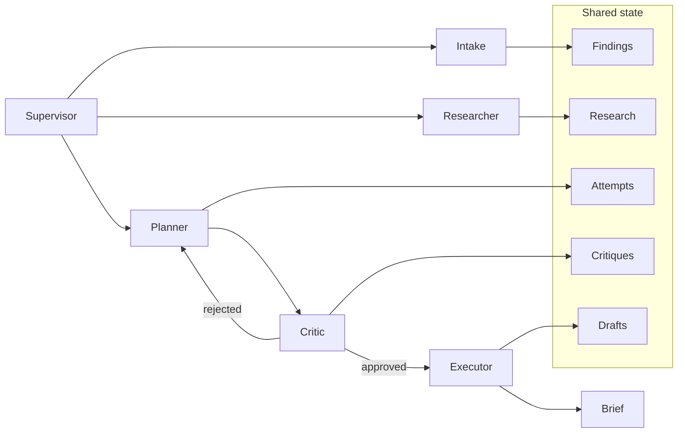
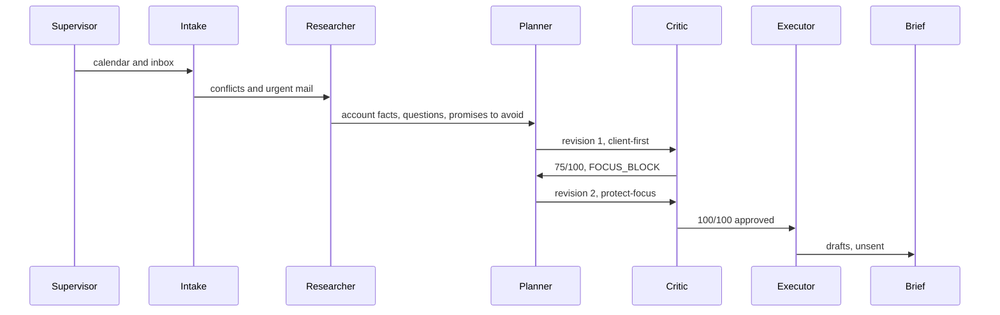

# Benchmark

**[Play the demo locally](#browser-demo)** — `npm run preview`, then open [http://127.0.0.1:4173](http://127.0.0.1:4173). Mock mode, no API key, nothing is sent.

Benchmark is a team of AI agents built for construction project managers. It takes care of the repetitive admin that eats up a PM's day, like turning requests into quotes, keeping schedules and subcontractors in sync, tracking permits and paperwork, and sending invoices. The PM steps in only for the decisions that actually need them. Every job runs from the first inquiry to final payment in one organized place, so nothing slips and the PM always knows where things stand.

## Where it saves time

- **Intake and quoting.** Emails, forms, and call notes become organized jobs automatically, and draft quotes are ready for review instead of being built from scratch.
- **Scheduling and subs.** Timelines are built and updated on their own, subcontractors get their assignments and reminders, and when a delay or bad weather hits, the schedule is reshuffled without a pile of phone calls.
- **Permits and compliance.** Permit deadlines, inspections, insurance certificates, and lien waivers are tracked automatically, so nothing expires or gets missed.
- **Billing.** Invoices go out when milestones are hit, change orders are logged, and late payments are followed up, so cash keeps coming in without manual chasing.
- **Daily clarity.** Each morning the PM gets a briefing covering what's happening today, which jobs are at risk, and what needs a decision. That replaces digging through texts, emails, and spreadsheets.
- **Control and trust.** Every agent action is visible and can be undone. The PM approves the key moments, so the automation never runs unchecked.

Less time on admin and follow-ups, fewer dropped balls, faster quotes and payments, and more of the PM's time spent on the jobs themselves.

Those savings are described by area. Specific before-and-after figures wait until a project manager has used it.

## The demo

The playable story is one fictional Thursday for Maria Alvarez at Summit Ridge Builders. At 8:47, Sam Rivera (FAKE) asks for a kitchen quote at 123 Example Ln. The calendar is already double-booked. Benchmark makes room for the call, keeps the estimate block, and drafts the email and the Slack note. Nothing is sent. Names, addresses, and job ids are invented.

```bash
npm install
npm run demo
```

## What the hero demo does

`npm run demo` opens the war room on that Thursday. On the page, the same run is four specialists under Benchmark: Intake, Scheduling, Compliance, and Briefing.

1. **Intake** reads the calendar and the inbox. Bright Spark's date check already overlaps the estimate block, and Sam has asked for a morning call.
2. **Research** pulls the Rivera kitchen off the fixture: job `J-1042`, a draft the PM has not approved, and an electrician whose insurance certificate is expired.
3. **Planner, first pass** clears calls as early as it can. The estimate block gets the largest hole left, which starts at 13:30. The biggest hole is the wrong hole.
4. **Critic** scores that plan 75/100 and hands it back with `FOCUS_BLOCK`. Lunch, the site walk, Dave's check-in, and the county window were fine. The morning was not.
5. **Planner, second pass** switches to `protect-focus`: Sam at 09:00–09:40, the estimate block held 09:40–11:20, Bright Spark moved to 13:45, the site walk left at 13:00.
6. **Executor** writes calendar diffs plus an email draft and a Slack draft, all marked `draft`.
7. **Brief** prints the three outcomes and a call card: what we know, what to ask, what not to promise.

The exchange that matters:

```text
08:47:34  CRITIC      75/100 · rejected
              FOCUS_BLOCK. Focus landed at 13:30–15:20. The escalation is allowed
              to shift it, not to push it out of the morning. The largest open gap
              was the wrong gap.
              → planner  Switch to protect-focus.

08:47:50  CRITIC      100/100 · approved
              Focus, the walk, lunch, the fixed meetings, and the deadline all hold.
              → executor  Materialize drafts. Do not send them.

08:48:06  BRIEF       Sam gets 09:00. The estimate block still happens.
              1. Call Sam at 09:00–09:40 and send the note by 12:15.
              2. Keep 09:40–11:20 to price J-1042.
              3. Move Bright Spark to 13:45–14:30.
```

`npm test` locks the same times. The quote total, when one is shown, is added by code.

## Three pillars

### 1. Calendar and day planning

A busy project-manager day has priorities that are easy to violate by accident: an estimate block, a site walk that can slide and cannot vanish, a check-in with the owner that does not move, and a county window someone else owns.

```bash
npm run demo:plan    # the overlap, the rejected plan, the diff
npm run demo:brief   # the same Tuesday as a morning brief, before 08:47
```

`demo:plan` is the planning loop before the email. The calendar is already lying: Bright Spark sits on the estimate block. Client-first scheduling then picks a 110-minute afternoon hole over a 95-minute morning one, and the critic rejects it. Protect-focus puts 09:00–11:00 back and moves the date check to 13:45. The brief turns that into three outcomes.

### 2. Multi-agent orchestration

One supervisor. One blackboard. Specialists that do not call each other.





| Piece | Where | Job |
| --- | --- | --- |
| Supervisor | `src/orchestrator/supervisor.ts` | The only router. Caps the loop at three revisions. |
| Blackboard | `src/memory/state.ts`, `RunState` in `src/types.ts` | Findings, research, every plan attempt, critiques, drafts, the trace. |
| Roles | `src/agents/roles.ts` | The contract each specialist would keep if a model sat behind it. |
| Agents | `src/agents/*.ts` | Intake, research, plan, critique, execute, brief. |
| Tools | `src/tools/toolkit.ts` | Read-only calendar, inbox, and account lookup. |
| Critic | `src/schedule/critique.ts` | A named checklist. It does not quietly fix the plan. |

`npm run demo:trace` prints the war room as JSON: handoffs, scores, the approved schedule, and the unsent drafts.

### 3. War room, the hero

Pillars 1 and 2 are the machinery. The war room is the demo you can finish in a few minutes: email, then research, then a schedule argument, then calendar moves, a Slack draft, an email draft, and a call card.

The pipeline is the whole `npm run demo` run. The call card is specific on purpose. It tells Maria not to promise a price or a start date, and not to say the electrician is confirmed while the certificate is expired.

## Design choices

1. **The schedule is a pure function.** Two strategies live in `src/schedule/plan.ts`. `client-first` places client meetings early, keeps lunch and the walk, then drops focus into the largest remaining gap. `protect-focus` places a true escalation first, reserves a morning block of at least 90 minutes, then fits everyone else. Re-running the demo prints the same day.
2. **A model is optional prose polish.** `npm run demo` is mock mode even if a key is sitting in the environment. `npm run demo:live` can restyle the brief and the drafts when `BENCHMARK_PROVIDER=openai` and `OPENAI_API_KEY` are set. `ATLAS_PROVIDER` still works. The prompt tells it to keep times, names, and job ids. Schedule decisions, quote totals, and dates stay in code. If the call fails, the deterministic draft stands.
3. **The critic is allowed to say no.** The handoff is a named failure. The planner picks the next strategy from that failure.
4. **Drafts stay in the process.** Calendar, email, and Slack actions are `status: "draft"`. There is no send path to wire by accident.
5. **The constraints are the point.** The estimate block has a 90-minute floor. The site walk can move up to 90 minutes and cannot be deleted. Dave's check-in and the Pinecrest 15:30 window are fixed. Calls get a prep buffer. Fixed meetings keep a 10-minute lead-in.
6. **Small modules.** No agent framework. The supervisor is about a hundred lines. The whole `src/` tree is there to be read.

## Sample day

Thursday, March 12, 2026. Working hours 08:30–17:30. Maria Alvarez, project manager, Summit Ridge Builders.

| When | What | Rule |
| --- | --- | --- |
| 08:30–08:45 | Morning huddle | Fixed |
| 09:00–11:00 | Estimate block · J-1042 | Protected, floor 90 minutes |
| 10:30–11:15 | Bright Spark date check | Movable, and already overlapping the estimate block |
| 11:30–12:00 | Check-in with Dave | Fixed |
| 12:00–12:45 | Lunch | At least 30 minutes, around noon |
| 13:00–13:30 | Site walk · 123 Example Ln | Protected, may slide, may not disappear |
| 14:00–15:00 | Crew schedule review | Movable |
| 15:30–16:00 | Pinecrest rough-in window | Fixed county window |
| 16:30–17:00 | Daily closeout | Movable |

At 08:47 Sam Rivera (FAKE) writes about a kitchen at 123 Example Ln. Sam wants a call this morning and a note by 12:15. The fixture lives in `src/fixtures/tuesday.ts`.

## Browser demo

The page in `docs/` runs the same `runWorkflow` function as the CLI. The top of the page is the product: what Benchmark does for a project manager, and where the time goes, without invented savings numbers. It starts from the system light or dark setting. The switch at the top right flips between them. When the war room finishes, Play demo sits centered under the title. The header shows three connected systems as icon bubbles: HubSpot, Google Calendar, and Slack. Play, pause, or step the war room. The first plan is rejected, then the day flips. **Day plan** and **Brief** are the other tabs. Drafts are labeled not sent. Deep links: `#war`, `#plan`, `#brief`.

```bash
npm install
npm run preview
```

Open [http://127.0.0.1:4173](http://127.0.0.1:4173).

### Sharing it while the source stays private

Public GitHub Pages is not available to hiring teams on a private repository. This repo is meant to stay private, so `https://saltylvn.github.io/benchmark-ai/` is not a public hiring link. The demo is a static folder (`docs/index.html`, `docs/styles.css`, `docs/app.js`) with no keys in it. Publish that folder on its own if you want a passwordless URL:

- Deploy `docs/` to any public static host (Netlify, Cloudflare Pages, S3, a separate **public** repo that contains only that folder).
- Or, only if this repository is public, enable GitHub Pages with source **GitHub Actions**. `.github/workflows/pages.yml` publishes `docs/` on each push to `main`, at `https://saltylvn.github.io/benchmark-ai/`.

Making the repository private turns that Pages URL off for anyone without repo access. The local preview keeps working.

## Run it

Node 20 or newer.

```bash
npm install
npm test
npm run typecheck
npm run demo
npm run demo:plan
npm run demo:brief
npm run demo:trace
npm run demo:all
```

| Script | What you get |
| --- | --- |
| `npm run demo` | War room. The hero. |
| `npm run demo:plan` | Day planner: priorities, the conflict, both revisions, the diff. |
| `npm run demo:brief` | Morning brief for the same Tuesday, inbox still quiet. |
| `npm run demo:trace` | War room as JSON, including role cards and unsent drafts. |
| `npm run demo:all` | Plan, brief, then war room. |
| `npm run demo:live` | Same as `demo`, with optional prose polish. |
| `npm test` | Scheduler properties and both workflows. |
| `npm run preview` | Browser demo on port 4173. |
| `npm run build:web` | Rebuild `docs/app.js` for GitHub Pages. |
| `npm run typecheck` | `tsc --noEmit`, including the browser demo. |

Mock mode is the default, including when `OPENAI_API_KEY` happens to be set. Live polish is opt-in:

```bash
cp .env.example .env
# BENCHMARK_PROVIDER=openai
# OPENAI_API_KEY=...
npm run demo:live
```

`.env` is gitignored. The example file has empty values. Fixture addresses use `*.example`.

Color follows the terminal. Set `NO_COLOR=1` for plain text.

## Layout

```text
src/
  agents/            one file per specialist, plus role cards
  orchestrator/      supervisor loop
  memory/            trace and finding helpers
  schedule/          strategies, critique checklist, draft builder
  tools/             read-only calendar, inbox, accounts
  providers/         mock model, optional OpenAI prose polish
  fixtures/          the Tuesday
  render/            terminal layout
  cli.ts             war-room | plan | brief | trace | all
web/main.ts          browser shell around the same team
docs/                GitHub Pages demo (index, styles, built app.js)
tests/               node:test, via tsx
docs/war-room.png    the approved rewrite
```

A good reading order: `src/orchestrator/supervisor.ts`, `src/schedule/plan.ts`, `src/schedule/critique.ts`, `src/fixtures/tuesday.ts`.

## License

[MIT](LICENSE).
