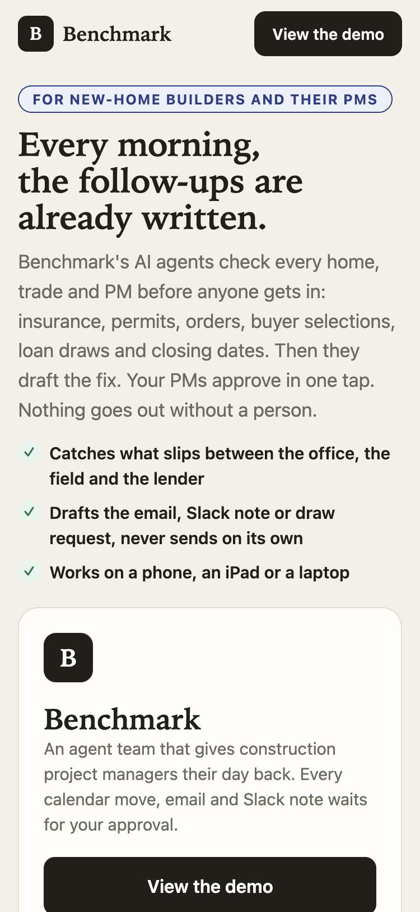
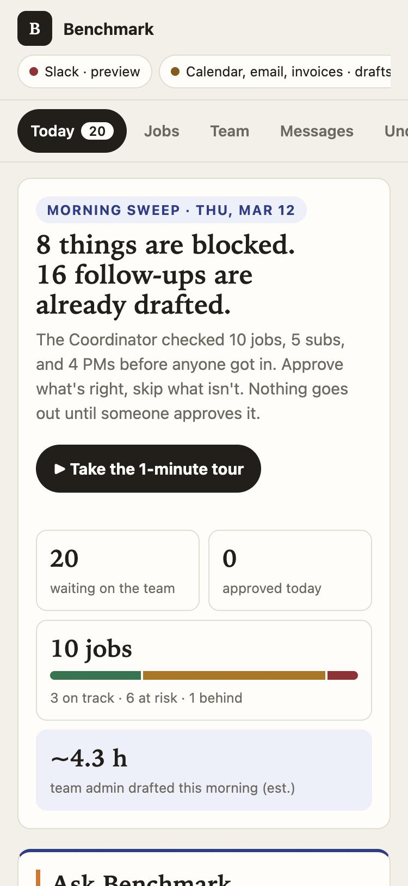
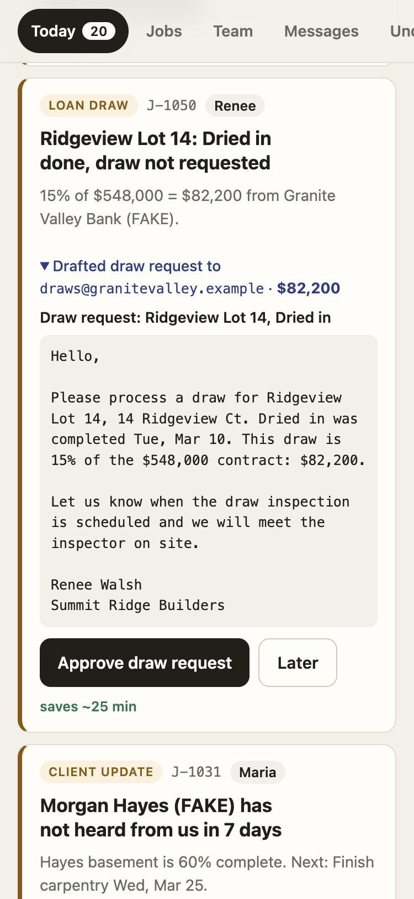
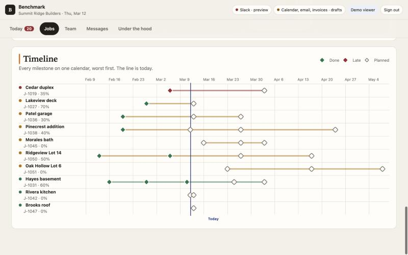
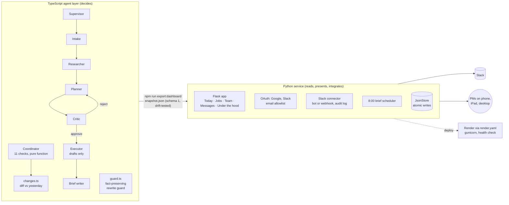

# Benchmark

**An agent team for new-home builders. Every morning it checks every home, trade and project manager, then drafts the follow-ups. A person approves anything before it leaves the building.**

[](https://github.com/saltylvn/benchmark-ai/actions/workflows/ci.yml)
&nbsp;**Live demo:** [benchmark-qypb.onrender.com](https://benchmark-qypb.onrender.com) (tap **View the demo**; the free host may take ~1 minute to wake)

<p>
  
  
  
</p>


---

## The problem

A new-home PM runs 6 to 10 houses at once, each with a lender, a buyer, 15 to 25 trades and a closing date. Most of the day goes to checking things nobody else is checking: is the electrician's insurance current, were the trusses ordered in time, did the buyer pick cabinets, has the draw been requested, will we still make closing? Each miss costs real money.

## What Benchmark does

| Every morning the Coordinator agent checks | and drafts |
| --- | --- |
| Sub insurance against booked work | A Slack nudge to the sub |
| Permits and inspections | A permit extension request; who meets the inspector |
| Lien waivers before final payment | The waiver chase |
| Completed milestones | A **construction-loan draw request to the lender** (or an invoice) with the amount computed by code |
| Buyer selections due or overdue | A reminder to the buyer |
| Long-lead orders (need-by date minus lead time) | An order email to the vendor |
| Closing dates against the projected finish | A heads-up to the owner and PM |
| Crews double-booked, quotes due, late milestones | A proposed resolution |
| PM workload against capacity | A handoff proposal |

The PM gets one queue: **Approve** or **Later** on each card, a "since yesterday" diff, a two-week look-ahead, a status board and timeline, team load, an 8:00 Slack brief, and a guided tour. It works on iPhone, iPad and desktop and installs to the home screen.

---

## Architecture



**Two layers on purpose.** The TypeScript agents *decide*: every date, dollar amount and conflict is computed by plain, tested code. The Python service only *reads* the snapshot the agents export and handles people and integrations: sign-in, approvals, Slack and the brief. A test fails if the committed snapshot drifts from what the agents produce, so the UI can never show a plan the agents didn't make.

### The agents

- **Coordinator** ([`src/agents/coordinator.ts`](src/agents/coordinator.ts)): a pure function of the portfolio and the date. It runs 11 checks across every job, sub and PM, returns `risks`, `drafts`, `statuses`, `workload` and a step log, and never sends anything. Every risk carries a stable `key`, so [`changes.ts`](src/agents/changes.ts) can diff two mornings into "slipped / moved forward / new".
- **Supervisor team** ([`src/orchestrator/supervisor.ts`](src/orchestrator/supervisor.ts)): a request-level workflow (Intake → Researcher → Planner → **Critic** → Executor → Brief). The Critic scores each plan against the PM's rules and sends rejected plans back, so the run includes a real reject-and-retry. Only the supervisor routes, and specialists never call each other.
- **Language models are optional and guarded.** Mock mode is the default. A live model may only restyle prose. [`guard.ts`](src/providers/guard.ts) extracts every time, dollar amount, ID, date, percent, channel and email from the draft, and rejects a rewrite that drops, changes or adds one, or grows more than 1.6×.

## Integrations and APIs

| Integration | How |
| --- | --- |
| **Slack** | Bot token (`auth.test` for status, cached 60 s; `chat.postMessage` to send) or an incoming webhook restricted to `hooks.slack.com`. Every send and preview goes to an audit log. Two locks: `SLACK_SEND_ENABLED=1` **and** a signed-in approver. Demo sessions can never post. |
| **Sign in with Google / Slack** | OAuth authorization-code flow with a `state` check, userinfo for name and email, refusal of unverified emails, and an `ALLOWED_EMAILS` / `ALLOWED_EMAIL_DOMAINS` allowlist. |
| **JSON API** | `/api/team`, `/api/snapshot`, `/api/runs/<key>`, `/api/slack/status`, `/api/slack/audit`, and `POST /api/approve` (session plus per-session CSRF token). |
| **Scheduled brief** | `BRIEF_AT=08:00` runs a scheduler thread that posts the team brief once a day, and skips a brief that was due before startup. |
| **Deploy** | [`render.yaml`](render.yaml) Blueprint: gunicorn, one worker by design (file-backed state, single scheduler), `ProxyFix` for HTTPS behind Render, `/healthz` that checks the data loads, auto-deploy from `main`. |
| **Link previews and PWA** | Open Graph and Twitter tags with absolute URLs, a web manifest, iOS icons, and versioned asset URLs so phones never keep stale CSS. |

## Engineering highlights

- **Evaluation by invariants.** [`tests/coordinator.properties.test.ts`](tests/coordinator.properties.test.ts) runs the Coordinator on **300 seeded random portfolios**, including new-build fields, and checks rules that must always hold:
  - it only drafts, and every draft answers a risk
  - it never bills past the contract
  - draws go only to lenders
  - client emails never mention subs, insurance or lien waivers, or quote a past date
  - risk keys are unique
  - the day-over-day diff is symmetric

  The first run found two real bugs: a crash, and a client email that promised a date that had already passed.
- **Security:** OAuth `state`, per-session CSRF, `HttpOnly`/`SameSite=Lax`/`Secure` cookies, CSP with `frame-ancestors 'none'`, `nosniff`, `X-Frame-Options: DENY`, and secrets only in environment variables. The git history was scanned for keys before publishing.
- **Reliability:** atomic JSON writes under a lock (a corrupt file is set aside, not fatal), a schema check on the snapshot that returns a helpful 503 instead of crashing, and JSON loads cached per file change.
- **CI:** typecheck and the Node tests, then ruff and the Python tests on 3.10 and 3.12.

| | |
| --- | --- |
| **Agents** | TypeScript, Node 20, `node:test` via `tsx`, esbuild |
| **Service** | Python 3.10+, Flask 3, Jinja, gunicorn, ruff |
| **Front end** | Server-rendered HTML, plain JavaScript, CSS tokens for light and dark, installable PWA |
| **Infra** | Render (Blueprint), GitHub Actions |
| **Tests** | 67 TypeScript (fixtures and property tests) and 63 Python (routes, OAuth, Slack, scheduler, security, deploy) |

## Design decisions

1. **Drafts only, a named person approves.** Construction teams trust automation with buyers, lenders and subs only if nothing leaves without a person. The code has no send path for email or invoices, and Slack sends need two locks.
2. **Code computes, models phrase.** Dates, dollars and schedule logic are deterministic and tested. A model may only reword, and the guard enforces that.
3. **Contract between layers.** One versioned snapshot (`schema: 1`), a drift test, and a schema check. The Python side never re-plans.
4. **Honest numbers.** Time saved comes from per-task minutes in [`dashboard/assumptions.json`](dashboard/assumptions.json) and is always labeled an estimate. The landing page shows the demo's own numbers, not invented customer counts.
5. **One worker, file-backed state.** It's the right size for a demo and a small team. The `JsonStore` interface is the seam for moving to Postgres.

## Run it locally

```bash
npm install && npm test && npm run typecheck          # agents
python3 -m venv .venv && .venv/bin/pip install -r dashboard/requirements-dev.txt
npm run dashboard                                     # export the snapshot, serve http://127.0.0.1:5050
.venv/bin/python -m unittest discover -s dashboard/tests -t .
npm run demo:team                                     # the morning check in the terminal
```

Configuration lives in [`.env.example`](.env.example). Deployment, Google and Slack setup are in [`docs/DEPLOY.md`](docs/DEPLOY.md).

## Repository map

```text
src/agents/        coordinator.ts (morning check), changes.ts (day-over-day diff), intake, researcher,
                   planner, critic, executor, briefWriter
src/orchestrator/  supervisor loop (the only router)
src/providers/     model.ts (mock by default), guard.ts (fact-preserving rewrite guard)
src/fixtures/      Summit Ridge Builders: 10 jobs including two new homes, plus yesterday's state
src/export/        snapshot.ts → dashboard/data/snapshot.json
dashboard/         app.py (routes, CSRF, security headers), auth.py (OAuth), slack.py, brief.py,
                   portfolio.py (view models), store.py, wsgi.py, templates/, static/
tests/             TypeScript fixture and property tests
dashboard/tests/   Python tests
docs/              DEPLOY.md, PLAN.md, the original Thursday showcase (docs/index.html)
render.yaml        one-click deploy
```

## Roadmap

- **Automation API:** token-protected endpoints and signed outbound webhooks, so tools like n8n can run the morning check, route approvals and log to Sheets.
- **Calendar:** a subscribable feed of the two-week look-ahead, then two-way Google Calendar.
- **Real data in:** spreadsheet import first, then a Procore connector into the same `Portfolio` shape.
- **Postgres** behind the `JsonStore` interface, and usage numbers (approval rate, edits before approval) to replace estimates with measurements.

## How this was built

I designed the product, the architecture and the guardrails, and directed and reviewed the work. The implementation was pair-programmed with AI coding agents (Claude Code and Cursor), as the commit history shows. That is a deliberate part of the project: shipping a tested, deployed system quickly with AI tools, while keeping humans in charge of design decisions, review and what the software is allowed to do.

## License

MIT. All people, companies, addresses and amounts in the demo are fictional.
