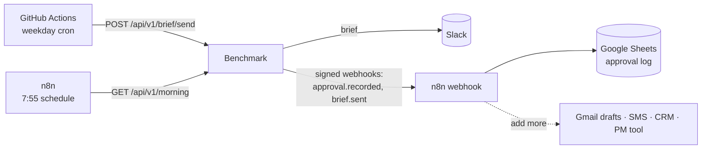

# Automation: API, webhooks, schedules, n8n

Benchmark does the checking and drafting. This layer lets other tools **run on a schedule, read the results, route approvals and keep records** without anyone copying data between apps. The core rule still holds: automations can read, post the internal brief, and record an approval *made by a named person*. Nothing approves itself.



## 1. Turn it on (Render → benchmark → Environment)

| Setting | What it is |
| --- | --- |
| `AUTOMATION_TOKEN` | Generated by Render from `render.yaml` (or set your own, 32+ characters). Machines send it as `Authorization: Bearer …`. If it's unset, the API is off. |
| `WEBHOOK_URLS` | Comma-separated **https** endpoints that receive events, for example your n8n webhook URL. |
| `WEBHOOK_SECRET` | Generated by Render. Receivers use it to check the signature. |

## 2. The API (`/api/v1`, bearer token)

| Method and path | Does |
| --- | --- |
| `GET /api/v1/morning` | Today's summary: job counts, blocked and waiting items, estimated minutes drafted, since-yesterday counts, every waiting item, and the brief text. Approved items drop out. |
| `GET /api/v1/queue?owner=renee&level=blocked` | The queue, filtered by PM and/or level. |
| `POST /api/v1/brief/send` `{"force": false}` | Posts the team brief to Slack **once per day** (safe to retry). It's a dry run until `SLACK_SEND_ENABLED=1`. Emits `brief.sent`. |
| `POST /api/v1/approvals` `{"id":"D6","act":"approve","by":{"name":"Renee Walsh","email":"renee@…"}}` | Records an approval or skip by a named person. The email must pass `ALLOWED_EMAILS` / `ALLOWED_EMAIL_DOMAINS`. Uses the same code path as the app (and the same Slack locks). Emits `approval.recorded`. |

```bash
curl -s https://benchmark-qypb.onrender.com/api/v1/morning -H "Authorization: Bearer $BENCHMARK_TOKEN" | jq '.blocked, .waiting'
```

Errors: `503` means the API is off (no token, or a token under 32 characters), `401` a wrong token, `400` a missing approver, `403` an approver not on the allowlist, `404` an unknown item, and `502` a Slack failure.

## 3. Webhooks (signed)

Events: `approval.recorded` (real approvals only; demo clicks are never sent) and `brief.sent`.

```json
{"at":"2026-03-12T14:05:00+00:00","data":{"act":"approve","by":"Renee Walsh","day":"2026-03-12","item":{"id":"D6","label":"Draw request: Ridgeview Lot 14, Dried in"},"via":"api", "...": "..."},"event":"approval.recorded","id":"<delivery uuid>"}
```

Headers: `X-Benchmark-Event`, `X-Benchmark-Delivery`, `X-Benchmark-Timestamp`, and `X-Benchmark-Signature: sha256=HMAC_SHA256(secret, "<timestamp>.<body>")`.

- **Canonical body:** sorted keys, no spaces, UTF-8, whole numbers as integers. A receiver can rebuild the exact bytes with `JSON.stringify(parsed)` (n8n, Node) or `json.dumps(parsed, sort_keys=True, separators=(",", ":"), ensure_ascii=False)` (Python).
- **Verify:** recompute the HMAC, compare in constant time, and reject timestamps more than 5 minutes old (replay protection). `dashboard/automation.py:verify` is a reference implementation. `tests/webhook.test.ts` proves a payload signed in Python verifies in the n8n template's JavaScript.
- **Delivery:** runs in the background with a 5-second timeout and up to 3 attempts (1 s, then 2 s backoff) on network errors, 5xx and 429. A 4xx is treated as a deliberate rejection and isn't retried. Every attempt is logged in the app's state (`webhookLog`), with query strings removed from URLs.
- Only `https://` URLs are allowed (plus `http://localhost` for local testing).

## 4. Free scheduler: GitHub Actions

[`.github/workflows/morning-brief.yml`](../.github/workflows/morning-brief.yml) runs on weekdays at 15:00 UTC (8:00 MST; change the cron for your timezone). It wakes the Render service, waiting up to 2 minutes for the free plan to start, then calls `POST /api/v1/brief/send`. Add two repo secrets: `BENCHMARK_URL` and `BENCHMARK_TOKEN`. **Run workflow** has a *force* switch. Without the secrets, it skips cleanly.

> Use either this or `BRIEF_AT`, not both. `BRIEF_AT` runs inside the web process, which sleeps on the free plan; GitHub Actions doesn't.

## 5. n8n templates ([`integrations/n8n/`](../integrations/n8n))

**`approvals-to-sheets.json`** (Webhook → Verify and shape → Google Sheets): every real approval becomes a row in an approval log with time, item, action, who and how.
1. In n8n: **Workflows → Import from file**.
2. In **Verify and shape**, replace `PASTE_WEBHOOK_SECRET_FROM_RENDER` with your `WEBHOOK_SECRET`. Self-hosted n8n needs `NODE_FUNCTION_ALLOW_BUILTIN=crypto`.
3. Pick your Google Sheet in the last node, then activate. Copy the webhook's **production URL** into `WEBHOOK_URLS` in Render.

**`morning-digest.json`** (Schedule 7:55 → HTTP GET /morning → Write the digest → Slack): a short digest of what's blocked, for a channel or (by swapping the last node) an email or SMS.
1. Import it, then create a **Header Auth** credential with `Authorization` = `Bearer <AUTOMATION_TOKEN>`.
2. Pick your Slack credential and channel.

## 6. Which automation tool?

| Tool | Free? | Strengths | Use it for |
| --- | --- | --- | --- |
| **GitHub Actions** | Yes (2,000 min/month on private repos, unlimited on public) | Already here, versioned with the code, secrets built in | Schedules: the brief, a nightly export, keeping the free host awake on weekday mornings |
| **n8n** | Yes, self-hosted (fair-code license); cloud is paid | 400+ integrations, visual editor, code nodes, retries, error workflows | Routing events to Sheets, Gmail, SMS, CRMs; human-in-the-loop forms |
| **Activepieces** | Yes, self-hosted (MIT); generous cloud free tier | Simpler editor, open license, growing set of integrations | The same jobs as n8n if you prefer MIT or a simpler interface |
| **Windmill** | Yes, self-hosted (AGPL) | Scripts first (Python/TS), strong for developer-owned jobs | Heavier data jobs like spreadsheet imports and nightly syncs |
| **Node-RED** | Yes (Apache 2.0) | Event and IoT flows | Job-site sensors and devices; overkill here |
| Zapier / Make | Limited free tiers | Fastest no-code setup | Quick experiments; cost grows with volume |

**Recommendation:** GitHub Actions for anything on a timer, and **n8n** for event routing. n8n is the most widely recognized, runs free in Docker (`docker run -p 5678:5678 n8nio/n8n`) or on a small VM, and its workflows are exportable JSON you can version next to the code, as this repo does.

## 7. More automation worth adding

- **Approve from Slack:** interactive buttons on each draft (Slack Block Kit plus a signed `/slack/actions` endpoint) that call the same approval path with the clicker as the approver.
- **Gmail and Outlook drafts:** on `approval.recorded` for an email draft, n8n creates the draft in the PM's mailbox. A person still presses Send.
- **Spreadsheet import:** a nightly n8n or Windmill job reads the builder's job sheet into the `Portfolio` shape, then re-runs the morning check.
- **Calendar feed:** an iCal (`.ics`) feed of the two-week look-ahead for Google, Apple or Outlook calendars.
- **SMS for blockers:** Twilio via n8n for items that are blocked and due today, sent to the owning PM.
- **Weekly owner report:** Friday 4 pm, wins, slips and closings at risk, as a PDF or email.
