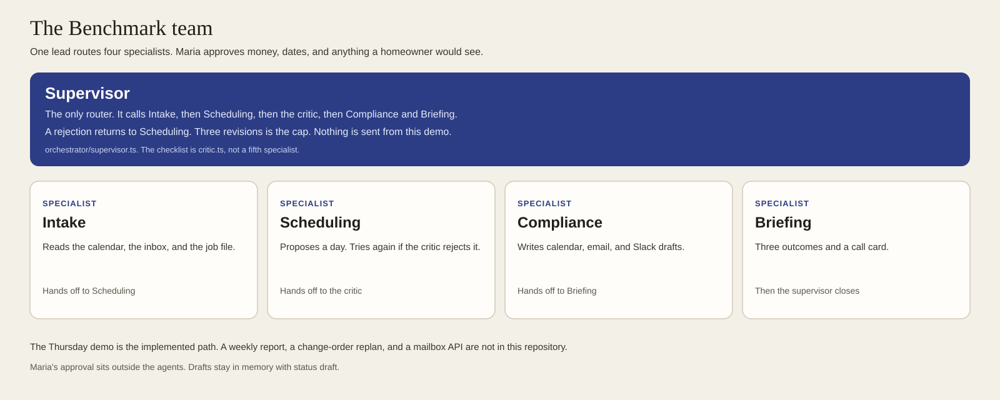
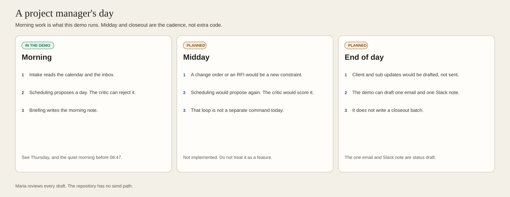
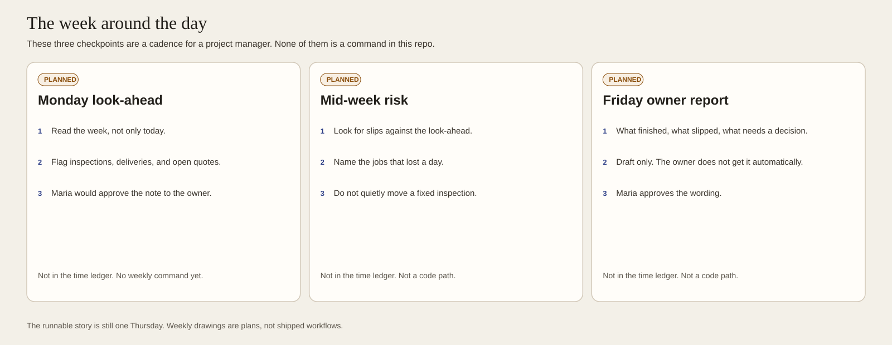
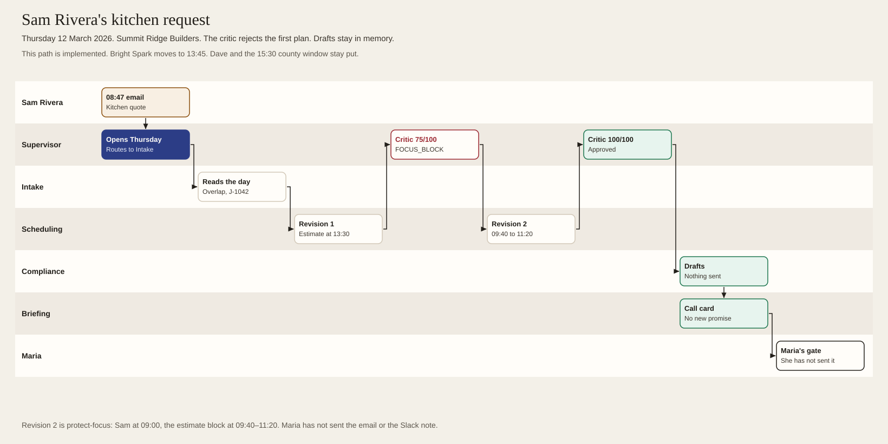
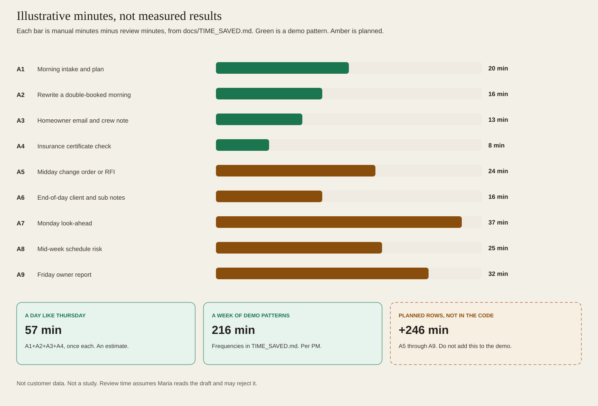
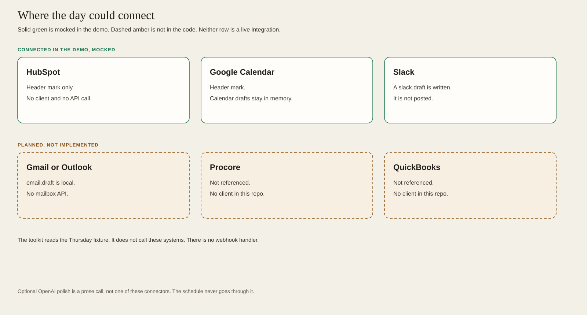
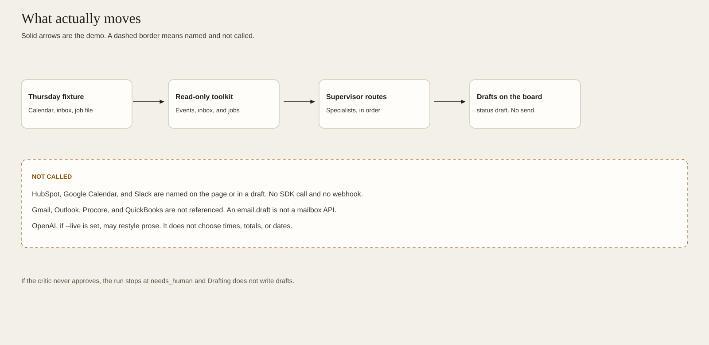
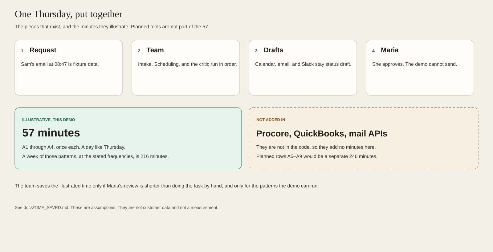

# Benchmark showcase

Drawings for hiring teams. They explain a construction project manager's demo: one lead, four specialists, drafts that are not sent, and Maria Alvarez approving the moments that matter.

Pictures are in `docs/images/showcase/`. `scripts/showcase.mjs` writes each SVG and its PNG. The palette matches the diagrams in `docs/images/`.

Two labels are used on purpose.

- **In the demo** means this repository runs that step.
- **Planned** means it is a cadence or a connector we have drawn and not built.

Any minute count comes from [TIME_SAVED.md](TIME_SAVED.md). Those counts are illustrative estimates from stated assumptions. They are not measurements and they are not customer data.

## The team

The supervisor is the only router. Intake reads the day, Scheduling proposes it, the critic can send it back, Compliance writes drafts, and Briefing writes the call card. Specialists do not call each other.

| Card | What to notice |
| --- | --- |
| [Supervisor](images/showcase/agent-supervisor.svg) | Starts Thursday or the quiet morning. Stops after three failed revisions. |
| [Intake](images/showcase/agent-intake.svg) | Calendar, inbox, and the job file. No schedule proposal. |
| [Scheduling](images/showcase/agent-scheduling.svg) | One plan per revision. `client-first`, then `protect-focus` if the critic rejects the morning. |
| [Compliance](images/showcase/agent-compliance.svg) | Runs only after a score of 100. Every action is `status: "draft"`. |
| [Briefing](images/showcase/agent-briefing.svg) | Three outcomes and a call card. No further specialist. |

Each card lists triggers, inputs, outputs, tools, the hand-off, and where Maria approves. She approves money, dates, and anything a homeowner would hear. The demo has no send path.

## The day and the week

Morning is the runnable loop: intake, a plan, a possible rejection, a brief. Midday, for a change order or an RFI, is planned. End of day is planned too. The demo can draft one email and one Slack note during Thursday. It does not write a closeout batch.

Monday look-ahead, a mid-week risk check, and a Friday owner report are a cadence, not commands. Each one is marked planned.

This swimlane is the implemented Thursday. Sam's email at 08:47, Intake, Scheduling's first plan, the critic at 75/100, the second plan, the critic at 100/100, then drafts and the call card. Maria has not sent them. Bright Spark moves to 13:45. Dave and the 15:30 county window stay put.

## Automations

Each drawing is a before column and an after column, with the assumption id and the minute arithmetic in the subtitle.

| Drawing | Id | Status |
| --- | --- | --- |
| [Morning intake and plan](images/showcase/automation-morning.svg) | A1 | In the demo |
| [Rewrite a double-booked morning](images/showcase/automation-rewrite.svg) | A2 | In the demo |
| [Homeowner email and crew note](images/showcase/automation-draft.svg) | A3 | In the demo |
| [Insurance certificate check](images/showcase/automation-certificate.svg) | A4 | In the demo |
| [Midday change order or RFI](images/showcase/automation-midday.svg) | A5 | Planned |
| [End-of-day client and sub notes](images/showcase/automation-eod.svg) | A6 | Planned |
| [Monday look-ahead](images/showcase/automation-lookahead.svg) | A7 | Planned |
| [Mid-week schedule risk](images/showcase/automation-risk.svg) | A8 | Planned |
| [Friday owner report](images/showcase/automation-report.svg) | A9 | Planned |

The after column for a planned row says the command does not exist. Do not read those rows as features.

## Illustrative minutes

Green bars are demo patterns. Amber bars are planned and are not in the code.

- A day like Thursday, A1 through A4 once each, is **57 minutes**.
- A week of those patterns, at the frequencies in TIME_SAVED.md, is **216 minutes** per project manager.
- Planned rows A5 through A9 would be another **246 minutes**. They are not added to the demo totals.

Review time assumes Maria reads the draft and may reject it.

## Integrations

HubSpot, Google Calendar, and Slack are mocked in the demo. HubSpot is a header mark with no client. Calendar and Slack drafts are written in memory and not delivered. Gmail, Outlook, Procore, and QuickBooks are not referenced. An `email.draft` is not a mailbox API.

The only solid path is fixture, read-only toolkit, the supervisor routing specialists, and drafts on the board. There is no webhook. If the critic never approves, Compliance does not write drafts. Optional model polish, when `--live` is set, may restyle prose. It does not choose times, totals, or dates.

Request, team, drafts, Maria. The 57 minutes belong to that path. Planned tools are drawn beside it and do not add minutes.
